# Netflix Music: Product Analysis

Product Management project: **Launching Netflix Music, personalized streaming for audio enthusiasts.**

This code reads `data/Netflix_Dataset.xlsx` (3 tables), computes the analysis, and generates every chart, framework visual and the PowerPoint write-up for the project.

## Product thinking in one line

> How might we turn what members watch into what they love to listen to?

The project starts with **the art of why** (why Netflix should build this at all), defines the **problem** from the customer research, and delivers an **MVP** where every feature answers a defined problem and tests one hypothesis.

## What the code does

| Step | Dataset table | Output |
| --- | --- | --- |
| Customer research and personas | Users (10 users) | Segment summary, pain-point and motivation themes, 3 personas, jobs to be done |
| User journey mapping | Journey (4 stages x 3 segments) | One journey map per persona with emotion curve, pain points, opportunities |
| Idea Funnel | Users + Journey | 20 ideas -> 15 screened -> 12 refined -> 5 MVP features |
| Competitive analysis | Market view | Benchmark heatmap, SWOT, BCG matrix |
| Feature prioritization | Features (5 features) | RICE, WSJF, value vs effort, Kano, MoSCoW, combined ranking |
| MVP and roadmap | All | MVP definition and scope, 4-phase roadmap, KPIs |

### Formulas

- **RICE** = Reach x Impact x Confidence / Effort
- **WSJF** = (Business Value + Time Criticality + Risk Reduction) / Effort

### Key result

| Feature | RICE | WSJF | Decision |
| --- | --- | --- | --- |
| AI-Generated Personalized Playlists | 144,000 | 4.80 | MVP (Must) |
| Music Discovery Based on Netflix Watch History | 129,600 | 4.80 | MVP (Must) |
| Mood-Based Music Recommendations | 74,667 | 3.50 | User Growth (Should) |
| Social Sharing and Collaborative Playlists | 42,000 | 2.57 | User Growth (Could) |
| Podcast + Music Hybrid Experience | 31,500 | 2.25 | Later (Won't, for now) |

## Gallery

Every figure is generated by the code in this repo (`python build_visuals.py`). The full set is in [docs/figures](docs/figures), the one-file version is [Netflix_Music_Visuals.pdf](docs/Netflix_Music_Visuals.pdf), and the final deck is [Netflix_Music_Project_Report.pptx](docs/Netflix_Music_Project_Report.pptx).

### The art of why

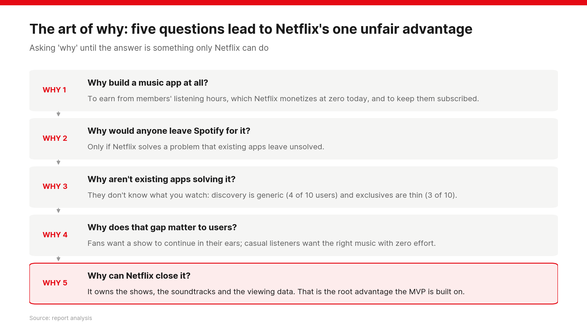

### Problem definition

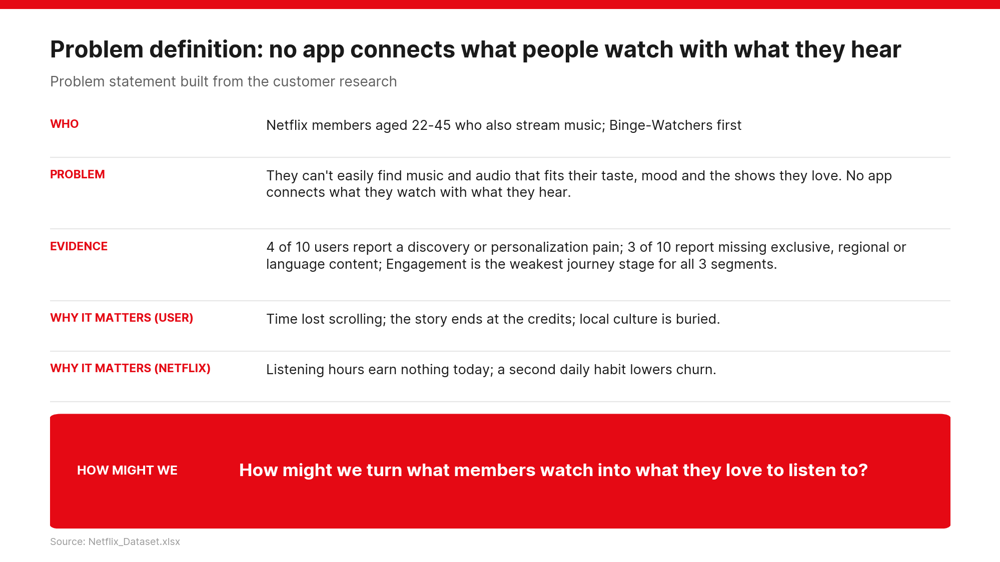

### Who the users are

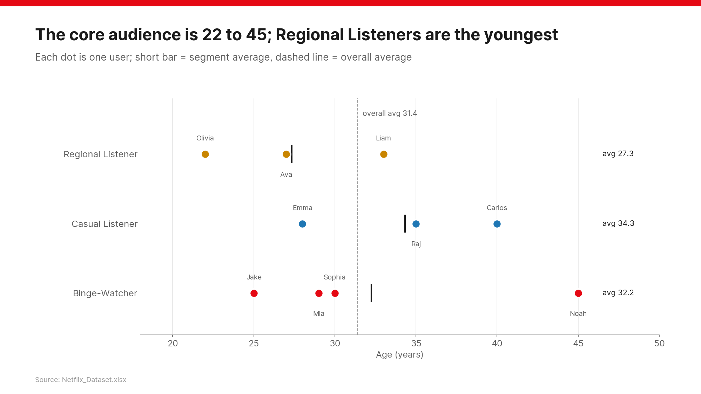

### Journey map: Binge-Watcher

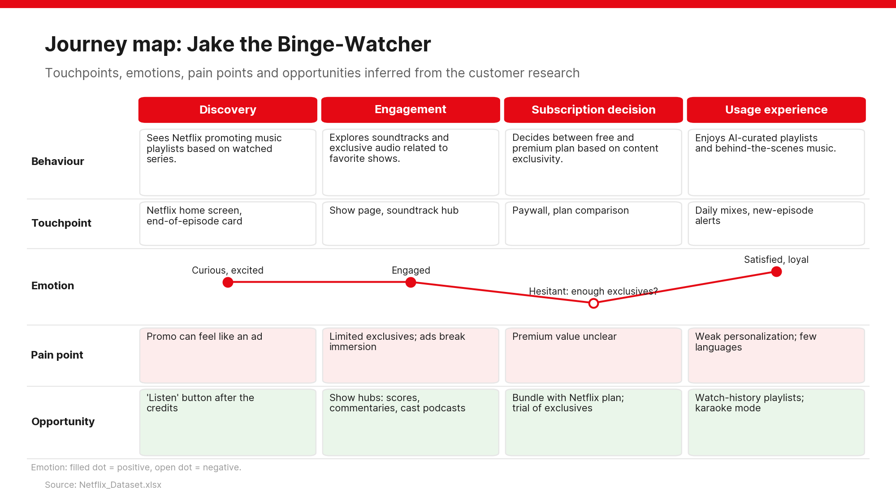

### Idea Funnel

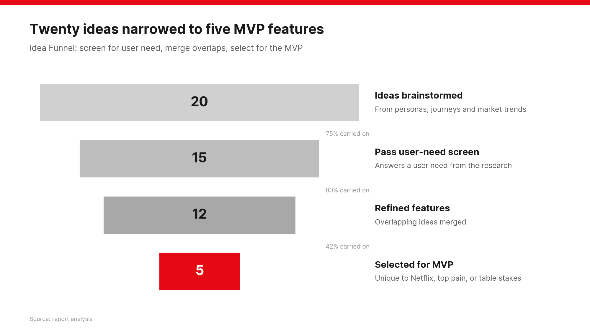

### SWOT analysis

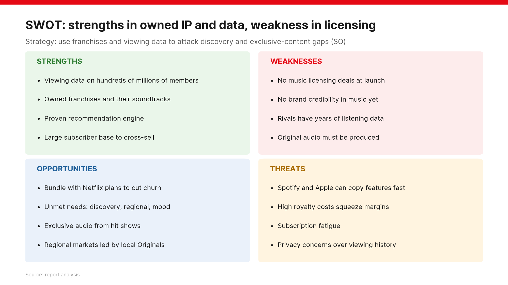

### BCG matrix

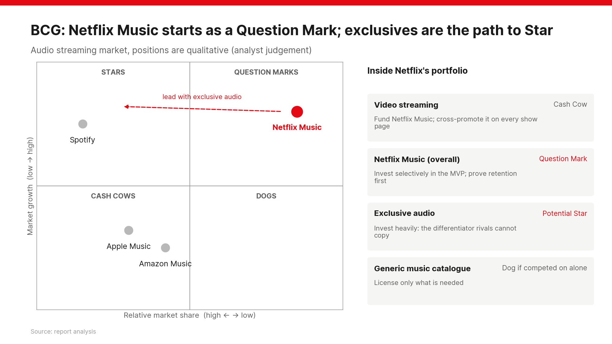

### Value vs effort

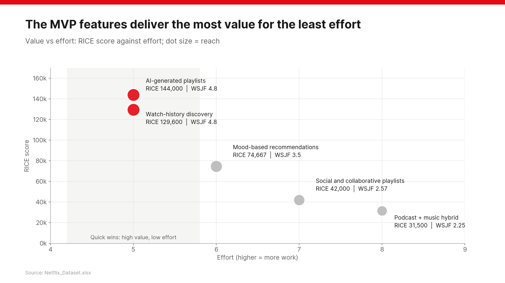

### Combined prioritization

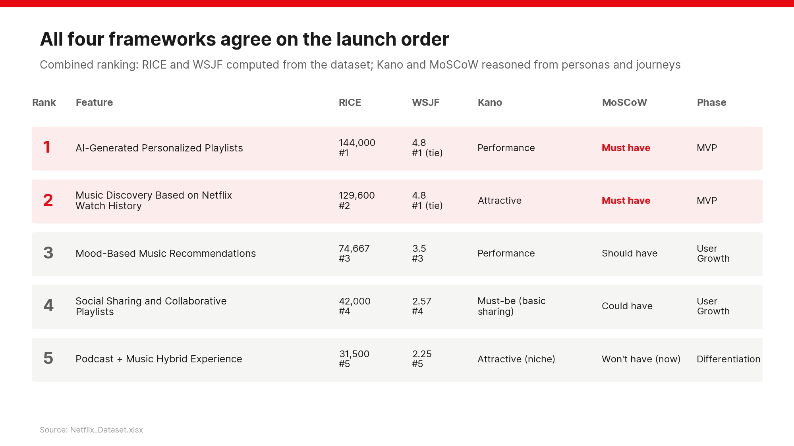

### MVP scope

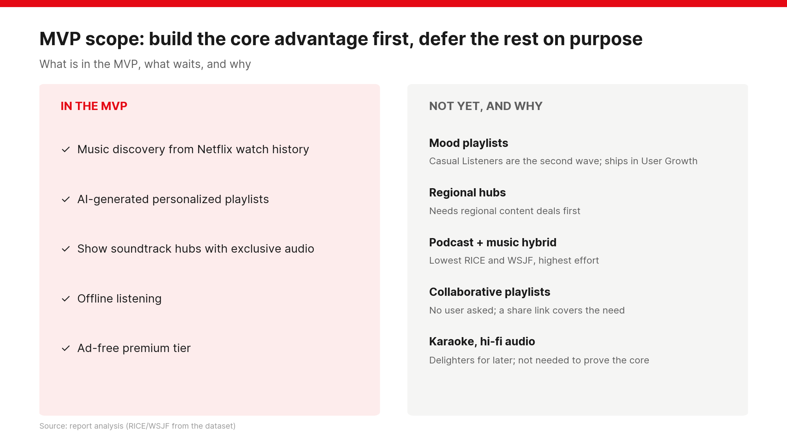

### Roadmap

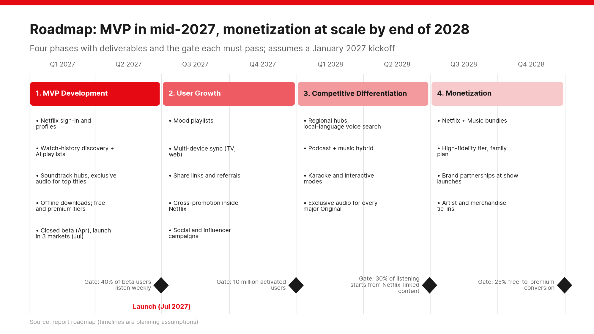

### Success metrics

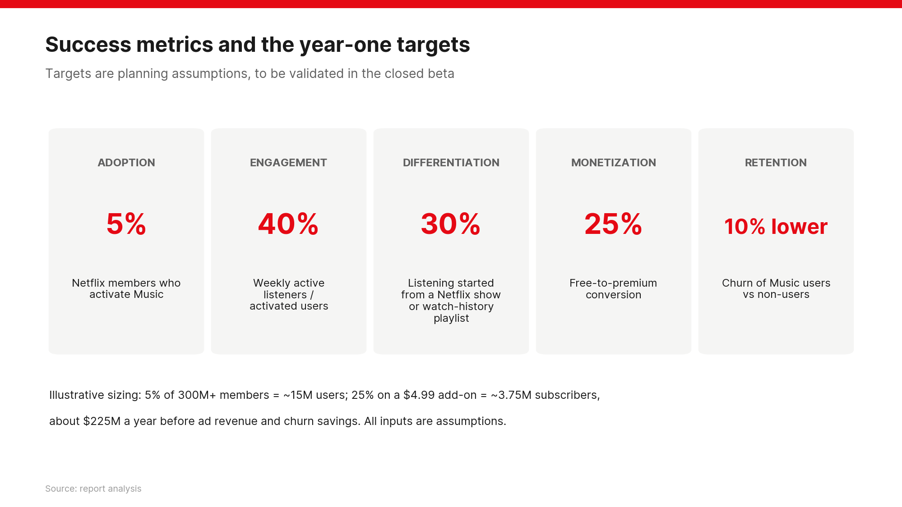

## Project structure

```
netflix-music-product-analysis/
├── data/Netflix_Dataset.xlsx   # input dataset (users, journey, features)
├── src/
│   ├── analysis.py             # loads the dataset tables, computes segments, themes, RICE and WSJF
│   ├── content.py              # personas, journeys, ideas, SWOT, BCG, Kano, MoSCoW, MVP, roadmap
│   └── charts.py               # every chart and framework visual (matplotlib)
├── build_visuals.py            # step 1-2: CSV tables + PNG figures + visuals PDF
├── build_deck.py               # step 3: PowerPoint write-up
└── requirements.txt
```

## How to run

```bash
python -m venv .venv && source .venv/bin/activate   # optional
pip install -r requirements.txt
python build_visuals.py        # writes output/tables, output/figures, output/Netflix_Music_Visuals.pdf
python build_deck.py           # writes output/Netflix_Music_Project_Report.pptx
```

To use another copy of the dataset: `python build_visuals.py path/to/Netflix_Dataset.xlsx`.

## Notes

- The users table has 10 users, so percentages describe the sample, not the market.
- Kano, MoSCoW, SWOT, BCG and the competitor ratings are analyst judgement reasoned from the dataset; RICE and WSJF are computed directly from the features table.
- Roadmap dates (January 2027 kickoff) and KPI targets are planning assumptions.
